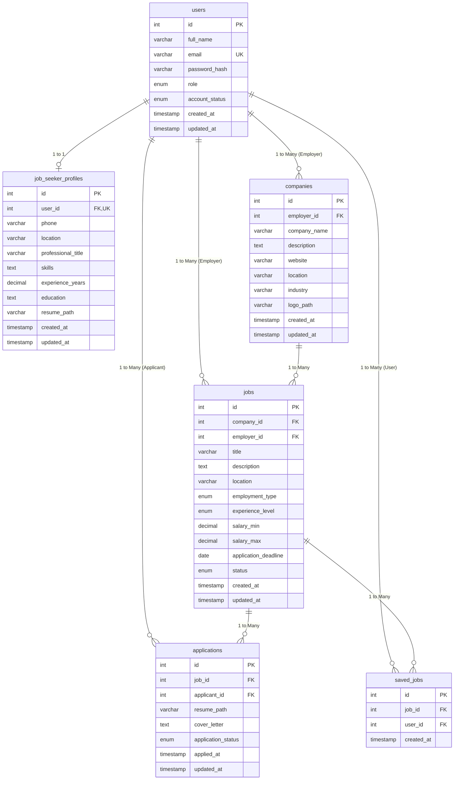

# JobConnect — Recruitment Platform

> **Project Tagline:** Connecting talent with opportunities.  
> **Internship:** Auspify Technologies Internship Advanced Task  
> **Status:** Phase 1 (Project Foundation) Completed  

---

## 1. Project Overview

**JobConnect** is a full-stack recruitment platform engineered to connect job seekers with top employers and recruiters seamlessly. The platform features strict role-based access control (RBAC), robust data validation, enterprise-grade MySQL schema design, and a modern component-driven React frontend.

The platform caters to three primary roles:
1. **Job Seeker**: Profiles, resume upload, job discovery & filtering, applications, and saved jobs.
2. **Employer / Recruiter**: Company profile management, job posting lifecycle (CRUD), and candidate application tracking.
3. **Admin**: System-wide analytics, job moderation, user account governance, and platform oversight.

---

## 2. Technology Stack

- **Frontend:** React.js 18, Vite 5, Custom CSS, Modern Fetch API
- **Backend:** Node.js (v25+), Express.js (v4.21+), ES Modules (`import`/`export`)
- **Database:** MySQL Server 8.0 (InnoDB, UTF-8 mb4)
- **Database Driver:** `mysql2/promise` (Connection Pooling + Parameterized Queries)
- **Security & Utilities:** `dotenv`, `cors`, `bcrypt` (Phase 2), `jsonwebtoken` (Phase 2)

---

## 3. Project Architecture

The repository enforces a clean separation of concerns between client and server:

```text
job-portal/
├── .git/                      # Git repository tracking
├── .gitignore                 # Root ignore rules (node_modules, .env, build artifacts)
├── README.md                  # Comprehensive project documentation
├── client/                    # Frontend React + Vite application
│   ├── .gitignore
│   ├── index.html
│   ├── package.json
│   ├── vite.config.js         # Vite configuration with /api reverse proxy
│   ├── public/
│   └── src/
│       ├── assets/            # Static assets and images
│       ├── components/        # Reusable UI components
│       ├── context/           # Global state / React contexts
│       ├── hooks/             # Custom React hooks
│       ├── layouts/           # Page layouts (Navbar, Footer, Sidebar)
│       ├── pages/             # Route-level pages
│       ├── services/          # API client services (fetch wrappers)
│       ├── styles/            # Custom CSS stylesheets
│       ├── App.jsx            # Main application component
│       └── main.jsx           # React DOM root entry point
└── server/                    # Backend Node.js + Express API
    ├── .env                   # Local environment secrets (ignored from git)
    ├── .env.example           # Sanitized environment template
    ├── .gitignore
    ├── package.json
    ├── database/
    │   └── schema.sql         # 6-table normalized DDL schema with indexes & FKs
    └── src/
        ├── app.js             # Express app setup, middleware, and route mounting
        ├── server.js          # HTTP server listener and DB health bootstrap
        ├── config/
        │   └── db.js          # MySQL2 connection pool & ping verification
        ├── controllers/       # HTTP request handlers (Phase 2+)
        ├── middleware/
        │   └── errorHandler.js# Centralized error handler & 404 handler
        ├── models/            # Database query layers (Phase 2+)
        ├── routes/
        │   └── healthRoutes.js# Health check routes (/api/health)
        ├── services/          # Business logic services (Phase 2+)
        └── utils/             # Helper utilities
```

---

## 4. Database Schema Design (`jobconnect_db`)

The database is built on **MySQL 8.0 InnoDB** with `ON DELETE CASCADE ON UPDATE CASCADE` foreign keys, custom status enumerations, and lookup indexes:



### Table Breakdown
1. **`users`**: Base credentials and role discriminator (`JOB_SEEKER`, `EMPLOYER`, `ADMIN`). Unique email constraint.
2. **`job_seeker_profiles`**: 1-to-1 profile linked to a job seeker user ID. Contains resume location, years of experience, and skills.
3. **`companies`**: Employer-managed company profiles with industry, website, and branding.
4. **`jobs`**: Detailed job postings linked to both company and employer. Includes salary ranges (`DECIMAL`), job type, and experience level.
5. **`applications`**: Job applications with unique compound constraint `(job_id, applicant_id)` preventing duplicate submissions.
6. **`saved_jobs`**: Bookmarked jobs with unique compound constraint `(job_id, user_id)` preventing duplicate bookmarks.

---

## 5. Installation and Setup Guide

### Prerequisites
- **Node.js**: v18+ (verified on v25.9.0)
- **npm**: v10+ (verified on v11.12.1)
- **MySQL Server**: 8.0+ running on port 3306

### Step 1: Clone or Navigate to Directory
```powershell
cd D:\Auspify\job-portal
```

### Step 2: Database Initialization
Import the schema into your local MySQL server:
```powershell
Get-Content server\database\schema.sql | & "C:\Program Files\MySQL\MySQL Server 8.0\bin\mysql.exe" -u root -p
```

### Step 3: Configure Environment Variables
Inside the `server/` directory, copy `.env.example` to `.env`:
```powershell
Copy-Item server\.env.example server\.env
```
Ensure the `.env` values match your MySQL credentials:
```env
PORT=5000
NODE_ENV=development
CLIENT_URL=http://localhost:5173

DB_HOST=127.0.0.1
DB_PORT=3306
DB_USER=jobconnect
DB_PASSWORD=ChooseYourOwnStrongPassword123!
DB_NAME=jobconnect_db
DB_CONNECTION_LIMIT=10
```

### Step 4: Install Dependencies
```powershell
# Install backend dependencies
cd D:\Auspify\job-portal\server
npm install

# Install frontend dependencies
cd D:\Auspify\job-portal\client
npm install
```

---

## 6. Running the Application

### Start Backend Server (Terminal 1)
```powershell
cd D:\Auspify\job-portal\server
npm run dev
```
- API Base URL: `http://localhost:5000`
- Health Endpoint: `http://localhost:5000/api/health`

### Start Frontend Client (Terminal 2)
```powershell
cd D:\Auspify\job-portal\client
npm run dev
```
- Web Application: `http://localhost:5173`

---

## 7. Current Development Status

- [x] **Phase 1: Project Foundation** *(Completed & Verified)*
- [ ] **Phase 2: Authentication and Authorization** *(Next)*
- [ ] **Phase 3: Job Seeker Module**
- [ ] **Phase 4: Employer Module**
- [ ] **Phase 5: Job Discovery & Filtering**
- [ ] **Phase 6: Application Workflow**
- [ ] **Phase 7: Admin Dashboard**
- [ ] **Phase 8: Testing and QA**
- [ ] **Phase 9: Deployment and Documentation**
