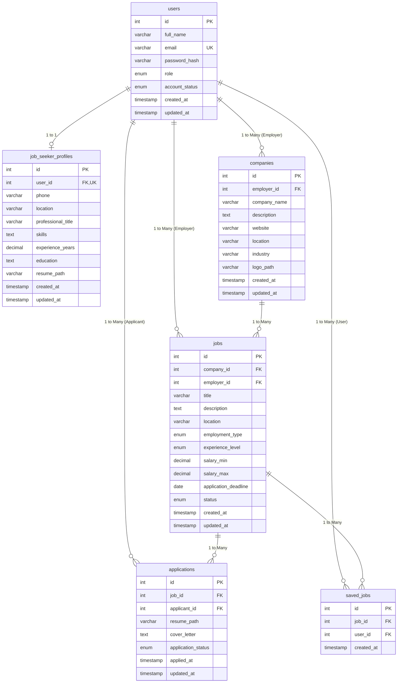

# JobConnect — Recruitment Platform

> **Project Tagline:** Connecting talent with opportunities.  
> **Internship:** Auspify Technologies Internship Advanced Task  
> **Repository:** [https://github.com/shenbagakasthuri/JobConnect.git](https://github.com/shenbagakasthuri/JobConnect.git)  
> **Current Status:** Core Recruitment Platform Implemented & Verified (Phases 1–6 Complete)

---

## 1. Project Overview

**JobConnect** is a modern full-stack recruitment and job application platform engineered to connect job seekers with employers and recruiters. The platform features strict role-based access control (RBAC), secure authentication with HTTP-only cookies, robust request validation, parameterized MySQL persistence, document-validated resume handling, and a responsive React frontend styled with an elegant purple/lavender glassmorphic mesh gradient design system.

The platform is designed around three distinct user roles:
1. **Job Seeker**: Explore jobs with full-text keyword and filter criteria, view comprehensive job details, submit applications with custom cover letters and resume uploads (`.pdf`, `.doc`, `.docx`), track personal application status history in real time, and download submitted resumes.
2. **Employer / Recruiter**: Post new career opportunities with company, salary, experience, and deadline metadata, manage active job listings, inspect incoming applicant pipelines per posting, review applicant resumes securely, and update candidate application statuses (`PENDING`, `REVIEWED`, `SHORTLISTED`, `REJECTED`).
3. **Admin**: Role-differentiated account architecture with access controls prepared for platform governance and monitoring.

---

## 2. Technology Stack

### Frontend Client
- **Framework:** React 18 (`react` v18.3.1, `react-dom` v18.3.1)
- **Routing:** React Router v7 (`react-router-dom` v7.18.5)
- **Build Tool:** Vite 5 (`vite` v5.4.11) with `@vitejs/plugin-react`
- **UI & Styling:** Custom CSS3 with layered radial mesh gradients, glassmorphism (`backdrop-filter`), CSS custom properties, and responsive grid/flexbox layouts
- **Icons & Visuals:** Pure inline SVG component architecture (`Icons.jsx`) with dynamic loading skeletons (`LoadingSkeleton.jsx`)
- **API Client:** Native Fetch API wrapper (`client/src/services/api.js`) configured with `credentials: 'include'` for automatic cookie transmission

### Backend API
- **Runtime & Framework:** Node.js (ES Modules, `type: "module"`), Express.js v4.21.2
- **Database:** MySQL Server 8.0 (InnoDB engine, UTF-8 mb4 encoding)
- **Database Driver:** `mysql2` v3.12.0 using Promise-based connection pools and strict parameterized queries
- **Authentication & Security:** 
  - `jsonwebtoken` (v9.0.3) for signed JWT tokens delivered via `HttpOnly`, `SameSite=Lax` cookies
  - `bcrypt` (v6.0.0) for salted password hashing (salt rounds: 10)
  - `cookie-parser` (v1.4.7) for secure cookie parsing
  - `cors` (v2.8.5) configured with explicit client origin and credentials support
- **File Uploads & Multipart:** `multer` (v2.5.0) with cryptographic filename obfuscation, 5 MB file size limit, and strict MIME/extension whitelisting (`.pdf`, `.doc`, `.docx`)
- **Input Validation:** `express-validator` (v7.3.2) sanitizing and validating registration, login, and application payloads

---

## 3. Repository & Project Structure

```text
job-portal/
├── .git/                          # Git repository tracking
├── .gitignore                     # Git ignore rules (node_modules, .env, build output)
├── README.md                      # Comprehensive project documentation
├── client/                        # Frontend React + Vite application
│   ├── index.html                 # HTML entry point
│   ├── package.json               # Frontend dependencies and build scripts
│   ├── vite.config.js             # Vite configuration with /api reverse proxy
│   ├── public/                    # Static public assets
│   └── src/
│       ├── assets/                # Static image assets
│       ├── components/            # Reusable components (Icons, LoadingSkeleton, ProtectedRoute)
│       ├── context/               # Global state (AuthContext with persistent session check)
│       ├── hooks/                 # Custom React hooks
│       ├── layouts/               # Structure layouts (Navbar, Footer)
│       ├── pages/                 # Application views (Home, Jobs, JobDetails, Login, Register,
│       │                          #   Dashboard, PostJob, MyJobs, MyApplications, JobApplicants)
│       ├── services/              # API abstraction layer (api.js)
│       ├── styles/                # Global styles (App.css with Option B Mesh Gradient)
│       ├── App.jsx                # Application routes and role-based guards
│       └── main.jsx               # React DOM root entry point
└── server/                        # Backend Node.js + Express API
    ├── .env.example               # Sanitized environment configuration template
    ├── package.json               # Backend dependencies and execution scripts
    ├── database/
    │   └── schema.sql             # 6-table normalized DDL schema with constraints & indexes
    ├── uploads/
    │   └── resumes/               # Secure local storage for uploaded candidate resumes
    └── src/
        ├── app.js                 # Express app assembly, middleware, and route mounting
        ├── server.js              # Server bootstrapper with DB health ping
        ├── config/
        │   └── db.js              # MySQL connection pool configuration
        ├── controllers/           # Route handler controllers (auth, job, application)
        ├── middleware/            # Security middleware (authMiddleware, errorHandler,
        │                          #   uploadMiddleware, validators)
        ├── models/                # Parameterized MySQL data access layer (user, job,
        │                          #   company, application)
        ├── routes/                # Express route endpoints (auth, job, application, health)
        └── utils/                 # Token generation and cookie helper utilities
```

---

## 4. Feature Implementation Status

To provide transparent visibility into the codebase, features are classified by their verified status in the repository:

### Implemented & Verified in Source Code
- [x] **Relational Database Foundation**: 6-table normalized MySQL 8 schema with InnoDB engine, primary keys, cascading foreign keys, unique email and compound application constraints, and performance indexes.
- [x] **User Authentication & Authorization**:
  - Registration with full name, email, password, and role selection (`JOB_SEEKER` or `EMPLOYER`).
  - Strict prevention of public `ADMIN` self-registration via backend validator.
  - Password encryption using `bcrypt` (10 salt rounds).
  - Login issuing signed JWT tokens stored in `HttpOnly`, `SameSite=Lax` cookies.
  - Automatic session restoration on page reload (`GET /api/auth/me`).
  - Secure logout clearing the authentication cookie (`POST /api/auth/logout`).
  - Role-based route protection on both frontend (`ProtectedRoute.jsx`) and backend (`verifyToken`, `requireRole`).
- [x] **Public Job Discovery & Search**:
  - Public job browsing with full-text search on job title and description (`GET /api/jobs`).
  - Multi-parameter filtering by location and employment type (`FULL_TIME`, `PART_TIME`, `CONTRACT`, `INTERNSHIP`, `REMOTE`).
  - Detailed single job view with company details, requirements, salary range, and deadline (`GET /api/jobs/:id`).
  - Responsive search filters with reset capabilities and dynamic active filter badges.
- [x] **Employer Job Management**:
  - Authenticated job posting form with automatic company creation/linkage (`POST /api/jobs`).
  - Dedicated employer dashboard viewing all posted jobs with live applicant counts (`GET /api/jobs/employer/my-jobs`).
  - Secure deletion of employer-owned job postings (`DELETE /api/jobs/:id`).
- [x] **Job Application Workflow & Candidate Tracking**:
  - Application submission modal for job seekers with cover letter and file upload (`POST /api/applications/:jobId`).
  - Duplicate application prevention enforced at both database (`UNIQUE KEY (job_id, applicant_id)`) and model levels.
  - Deadline validation rejecting expired job submissions.
  - Multer upload pipeline restricting files to `.pdf`, `.doc`, `.docx` up to 5 MB, stored outside public static directories with randomized filenames.
  - Job seeker application tracking dashboard showing applied jobs, company, submission dates, and status pills (`GET /api/applications/my-applications`).
  - Employer applicant pipeline screen showing all applicants per job with candidate details, cover letter modal, and resume download link (`GET /api/applications/employer/job/:jobId`).
  - Candidate status workflow allowing employers to update application status to `PENDING`, `REVIEWED`, `SHORTLISTED`, or `REJECTED` (`PATCH /api/applications/:applicationId/status`).
  - Secure authorization-guarded resume downloads restricted to the applying seeker, posting employer, or admin (`GET /api/applications/:applicationId/resume`).
- [x] **Design & User Experience**:
  - Full-surface purple/lavender mesh gradient styling (brand palette: `#9FA1FF` Periwinkle, `#B5BAFF` Soft Lavender, `#744577` Deep Plum).
  - Glassmorphic card surfaces (`backdrop-filter: blur(14px)`), accessible high-contrast typography, and fully responsive layouts across mobile, tablet, and desktop.

### Partially Implemented / Architectural Baseline
- [x] **Job Seeker Profiles (`job_seeker_profiles` table)**: Table created in schema and populated with default record upon user registration (`userModel.js`), but dedicated seeker profile editing UI is not yet built.
- [x] **Company Profiles (`companies` table)**: Companies table active with automatic profile instantiation during job creation (`companyModel.js`), but standalone company profile editing pages are planned for a subsequent update.
- [x] **Admin Governance**: Admin role defined in database ENUM, authorization middleware supports `ADMIN` overrides across all protected endpoints, and placeholder admin card renders on `/dashboard`, but dedicated system-wide moderation tables/screens are pending.

### Planned Features (Not Yet Implemented in Code)
- [ ] **Saved / Bookmarked Jobs**: Schema includes `saved_jobs` table, but backend API routes and frontend bookmarking buttons are planned for a future release.
- [ ] **Job Seeker Profile Edit Page**: Standalone resume upload in profile, skills tagger, and education history editor.
- [ ] **Email Notifications**: Automated transactional emails on application submission and status updates.
- [ ] **Admin Metrics Dashboard**: System-wide user moderation, job approval queues, and platform analytics.
- [ ] **Production Cloud Deployment**: Production CI/CD pipelines and cloud hosting configurations.

---

## 5. Database Schema Architecture (`jobconnect_db`)

The database is built on **MySQL 8.0 InnoDB** with `ON DELETE CASCADE ON UPDATE CASCADE` foreign keys and targeted query indexes:



---

## 6. Verified API Reference

All endpoints are prefixed with `/api`. Authenticated requests rely on the signed `token` HttpOnly cookie.

### Health Check
| Method | Endpoint | Access | Description |
| :--- | :--- | :--- | :--- |
| `GET` | `/api/health` | Public | Returns server status, timestamp, and database connection pool verification |

### Authentication (`/api/auth`)
| Method | Endpoint | Access | Description |
| :--- | :--- | :--- | :--- |
| `POST` | `/api/auth/register` | Public | Register a new user (`JOB_SEEKER` or `EMPLOYER`) |
| `POST` | `/api/auth/login` | Public | Authenticate credentials and receive HttpOnly session cookie |
| `POST` | `/api/auth/logout` | Public | Clear the HttpOnly authentication cookie |
| `GET` | `/api/auth/me` | Authenticated | Retrieve profile details of currently authenticated user |
| `GET` | `/api/auth/protected-seeker` | Seeker / Admin | Role verification test endpoint |
| `GET` | `/api/auth/protected-employer`| Employer / Admin | Role verification test endpoint |
| `GET` | `/api/auth/protected-admin` | Admin Only | Role verification test endpoint |

### Jobs (`/api/jobs`)
| Method | Endpoint | Access | Description |
| :--- | :--- | :--- | :--- |
| `GET` | `/api/jobs` | Public | Browse active jobs with `keyword`, `location`, `employmentType` query params |
| `GET` | `/api/jobs/:id` | Public | Fetch comprehensive single job details and associated company metadata |
| `POST` | `/api/jobs` | Employer / Admin | Create a new job posting with company linkage |
| `GET` | `/api/jobs/employer/my-jobs` | Employer / Admin | Retrieve all jobs posted by the authenticated employer |
| `DELETE`| `/api/jobs/:id` | Employer / Admin | Delete a specific job posting owned by the employer |

### Applications (`/api/applications`)
| Method | Endpoint | Access | Description |
| :--- | :--- | :--- | :--- |
| `POST` | `/api/applications/:jobId` | Seeker Only | Apply for an active job with `multipart/form-data` (coverLetter, resume file) |
| `GET` | `/api/applications/my-applications` | Seeker / Admin | List all applications submitted by the logged-in job seeker |
| `GET` | `/api/applications/employer/job/:jobId` | Employer / Admin | List all candidate submissions for an employer's job posting |
| `PATCH`| `/api/applications/:applicationId/status` | Employer / Admin | Update application status (`PENDING`, `REVIEWED`, `SHORTLISTED`, `REJECTED`) |
| `GET` | `/api/applications/:applicationId/resume` | Seeker / Employer / Admin | Secure download stream for candidate resume attachment |

---

## 7. Installation and Local Setup Guide

### Prerequisites
- **Node.js**: v18.0.0 or higher (tested on Node.js v25+)
- **npm**: v10.0.0 or higher
- **MySQL Server**: 8.0+ running locally or accessible via network

---

### Step 1: Clone Repository
```powershell
git clone https://github.com/shenbagakasthuri/JobConnect.git
cd JobConnect
```

---

### Step 2: Database Setup
1. Log in to your MySQL terminal or workbench:
   ```powershell
   mysql -u root -p
   ```
2. Execute the schema file located at `server/database/schema.sql` to initialize `jobconnect_db` and its 6 relational tables:
   ```powershell
   Get-Content server\database\schema.sql | & "C:\Program Files\MySQL\MySQL Server 8.0\bin\mysql.exe" -u root -p
   ```
   *(Adjust the path to your local `mysql.exe` as needed).*

---

### Step 3: Configure Environment Variables

Inside the `server/` directory, create a `.env` file based on `.env.example`:

```powershell
Copy-Item server\.env.example server\.env
```

Edit `server/.env` to configure your local credentials:

```env
PORT=5000
NODE_ENV=development
CLIENT_URL=http://localhost:5173

# Database Configuration
DB_HOST=localhost
DB_PORT=3306
DB_USER=your_mysql_username
DB_PASSWORD=your_mysql_password
DB_NAME=jobconnect_db
DB_CONNECTION_LIMIT=10

# JWT & Security Configuration
JWT_SECRET=use_a_strong_random_secret_at_least_32_characters_long
JWT_EXPIRES_IN=1d
JWT_COOKIE_EXPIRES_IN_DAYS=1
```

> **Security Note:** Never commit `.env` files to version control. The `.gitignore` file is preconfigured to exclude all `.env` files and local uploaded resumes.

---

### Step 4: Install Dependencies

Install dependencies for both the backend server and frontend client:

```powershell
# Install backend dependencies
cd server
npm install

# Install frontend dependencies
cd ../client
npm install
```

---

## 8. Running the Application

### Start the Backend Server (Terminal 1)
```powershell
cd server
npm run dev
```
- API Server listening at: `http://localhost:5000`
- API Health Check verification: `http://localhost:5000/api/health`

### Start the Frontend Client (Terminal 2)
```powershell
cd client
npm run dev
```
- Client Application available at: `http://localhost:5173`
- The Vite development server automatically proxies `/api` calls to the backend on `http://localhost:5000`.

### Production Build Verification
To test frontend compilation for production:
```powershell
cd client
npm run build
```

---

## 9. Security & Architecture Practices

- **Strict Parameterized Queries**: All MySQL queries in `models/` use bound parameters (`?`) to prevent SQL injection.
- **HttpOnly Cookie Storage**: JWT tokens are transmitted via `HttpOnly`, `SameSite=Lax` cookies to mitigate XSS-based token theft.
- **File Validation & Sanitization**: Resume uploads via `multer` enforce file extension and MIME type validation, file size limits (5 MB max), and store files outside public web roots with cryptographically randomized filenames.
- **Access Control on Downloads**: Candidate resumes are not exposed via static asset routing; downloads are routed through an authenticated controller verifying applicant, posting employer, or admin authorization.
- **Defensive Error Handling**: Centralized error-handling middleware (`errorHandler.js`) prevents leaking stack traces or internal database errors in production.

---

## 10. License & Acknowledgements

Developed as part of the **Auspify Technologies Internship Advanced Task**. Designed and engineered by [Shenbaga Kasthuri](https://github.com/shenbagakasthuri).
